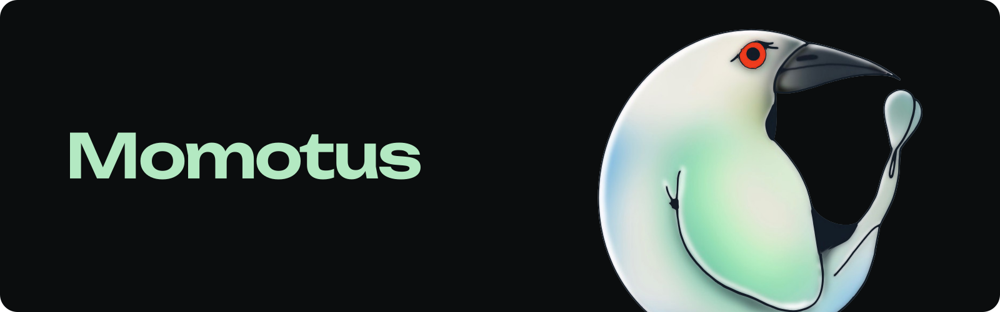

<p align="center">
  <picture>
    <source media="(prefers-color-scheme: light)" srcset="docs/readme/shelf-light.png">
    
  </picture>
</p>

<h1 align="center">Momotus</h1>

<p align="center">
  A media app for Stremio addons, on your phone, your TV and your computer.<br>
  Your library and where you left off follow you, end-to-end encrypted.
</p>

<p align="center">
  <a href="https://github.com/momotusx/momotus/releases">Releases</a> ·
  <a href="#features">Features</a> ·
  <a href="#build-from-source">Build from source</a>
</p>

<div align="center">
<table>
  <tr>
    <td align="center" width="200"><a href="https://github.com/momotusx/momotus/releases"><picture><source media="(prefers-color-scheme: light)" srcset="docs/readme/tile-android-light.svg"></picture></a><br><b>Android</b><br><sub><a href="https://github.com/momotusx/momotus/releases">64-bit APK</a></sub></td>
    <td align="center" width="200"><a href="https://github.com/momotusx/momotus/releases"><picture><source media="(prefers-color-scheme: light)" srcset="docs/readme/tile-androidtv-light.svg"></picture></a><br><b>Android TV</b><br><sub><a href="https://github.com/momotusx/momotus/releases">TV and Fire TV APK</a></sub></td>
    <td align="center" width="200"><a href="#build-from-source"><picture><source media="(prefers-color-scheme: light)" srcset="docs/readme/tile-mac-light.svg"></picture></a><br><b>Mac</b><br><sub><a href="#build-from-source">Build with Xcode</a></sub></td>
  </tr>
  <tr>
    <td align="center" width="200"><a href="#build-from-source"><picture><source media="(prefers-color-scheme: light)" srcset="docs/readme/tile-ios-light.svg"></picture></a><br><b>iPhone and iPad</b><br><sub><a href="#build-from-source">Build with Xcode</a></sub></td>
    <td align="center" width="200"><a href="#build-from-source"><picture><source media="(prefers-color-scheme: light)" srcset="docs/readme/tile-tvos-light.svg"></picture></a><br><b>Apple TV</b><br><sub><a href="#build-from-source">Build with Xcode</a></sub></td>
    <td align="center" width="200"><a href="#build-from-source"><picture><source media="(prefers-color-scheme: light)" srcset="docs/readme/tile-pc-light.svg"></picture></a><br><b>PC</b><br><sub><a href="#build-from-source">Run in a browser</a></sub></td>
  </tr>
</table>
</div>

## Why Momotus

- **A torrent plays in seconds.** On an iPhone 13 Pro, a public-domain film was ready in 5.8 s and showed its first frame at 6.2 s. [Measurement](bench/local-network/prompt.jsonl)
- **Light on an old TV stick.** On a 2018 Fire TV Stick 4K, cold starts took 0.791 to 1.751 s, Home used 127 MB of memory and playback 160.6 MB (debug build). [Measurement](bench/m6/journey-android.jsonl)
- **Smooth in a browser.** Home scrolls at 60 fps in Chromium, in the desktop and TV layouts: p99 frame time 16.8 ms, no frame over 33 ms. [Measurement](bench/web/scroll.jsonl)

## Compared

| | Momotus | Stremio | Nuvio |
|---|---|---|---|
| Stremio addons | Yes | Yes | Yes |
| Installable plugins | In progress | No (addons run no local code) | Yes, sideloaded builds |
| Android phone | Yes | Yes | Yes |
| Android TV and Fire TV | Yes | Yes | Yes |
| iPhone and iPad | From source | App Store (Lite), sideload | Sideload |
| Apple TV | From source | App Store (Lite), sideload | No |
| Mac | From source | Yes | Alpha |
| Web browser | From source | Yes | No |
| End-to-end encrypted sync | **Yes** | No | No |
| Torrent engine built in | Yes<sup>1</sup> | Yes | Yes, off by default |
| Offline downloads | In progress | No (planned) | Yes, on mobile |
| Dual subtitles | In progress | Not found | Not found |
| TV sign-in by QR code | Yes | Yes | Yes |
| Account needed | No | No (guest mode) | No (anonymous sign-in) |
| Licence | GPL-3.0-or-later | Web app GPL-2.0, core MIT | GPL-3.0 |

<sub>1. Not yet in 32-bit (armv7) builds, such as the Fire TV one. Checked on 27 October 2026 against each project's own site, docs and source code. [Sources](docs/readme/comparison-sources.md)</sub>

## Features

| | |
|---|---|
| **Addons** | Works with Stremio addons. Add one by its link; Home, Discover and Search fill from the addons you have. |
| **Sync** | Your library, progress and addons follow you to every device, end-to-end encrypted. Add a device by scanning the code it shows. |
| **Player** | Picks a version that plays and moves on when one stalls. Subtitles with search, timing and the languages you use. |
| **Torrents** | A built-in engine plays torrent sources inside the app, with no separate streaming server. Not yet in 32-bit (armv7) builds. |
| **Trakt** | Sign in with a code, even on a TV. What you watch is scrobbled as you watch it. |
| **Import** | Bring your library over from a Stremio account. |

## Install

**Android, Android TV and Fire TV.** Download the APK from the newest release on the [Releases](https://github.com/momotusx/momotus/releases) page, open it on the device and allow installs from that source. `momotus-android-arm64-phone.apk` is for phones, tablets and 64-bit TVs; `momotus-android-armv7-firetv.apk` is for 32-bit devices such as Fire TV sticks.

**Mac.** Build it with Xcode (below). It needs macOS 15 or later.

## Build from source

You need [Rust](https://rustup.rs) and [Bun](https://bun.sh).

```sh
git clone https://github.com/momotusx/momotus && cd momotus
```

**In a browser, on any computer.** The web app talks to the core over a local socket.

```sh
(cd apps/web && bun install && bun run build)
MQ_STATIC=apps/web/dist cargo run --release -p mq-bridge --features torrent
```

Then open http://127.0.0.1:7777.

**iPhone, iPad, Apple TV and Mac.** Needs Xcode and [XcodeGen](https://github.com/yonaskolb/XcodeGen).

```sh
rustup target add aarch64-apple-ios aarch64-apple-ios-sim aarch64-apple-tvos
cargo install --path apps/android/tools/uniffi-bindgen --locked
apps/apple/scripts/build-core.sh --tvos
xcodegen generate --spec apps/apple/project.yml
open apps/apple/Marquee.xcodeproj
```

Pick the iOS, tvOS or macOS scheme and your signing team.

**Android.** On a Mac, with JDK 21, the Android SDK and NDK 27.1.12297006.

```sh
rustup target add aarch64-linux-android armv7-linux-androideabi
cargo install cargo-ndk
cargo install --path apps/android/tools/uniffi-bindgen --locked
apps/android/scripts/build-core.sh
apps/android/scripts/gw.sh :app:assembleRelease
```

The APKs land in `apps/android/app/build/outputs/apk/release/`.

**Your own sync relay.** Devices sign up with the invite code. Behind a TLS proxy, add `--trust-proxy`.

```sh
cargo run --release -p mq-sync-server -- --db relay.db --listen 0.0.0.0:8787 --invite <code>
```

## Licence

GPL-3.0-or-later, see [LICENSE](LICENSE). Momotus is not affiliated with Stremio.
